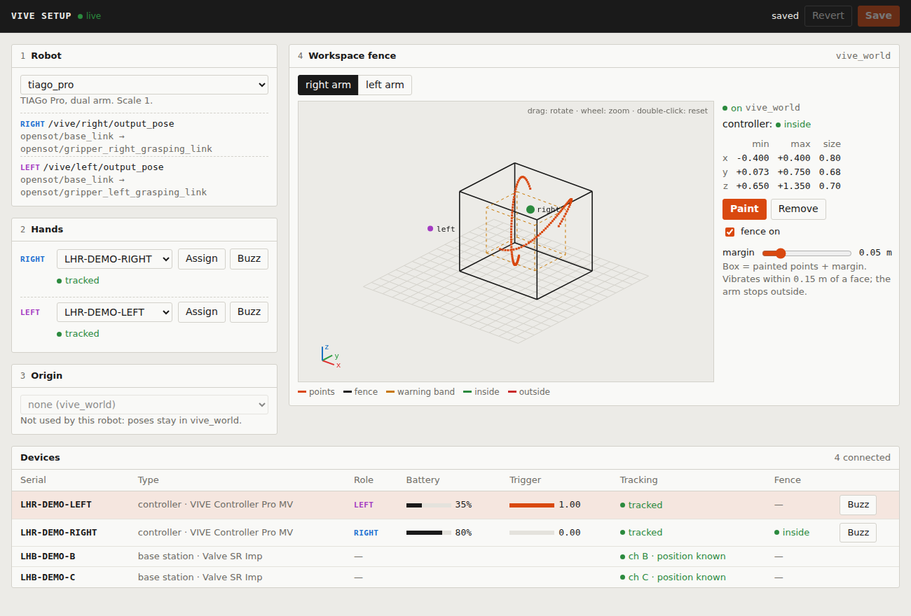

# ROS 2 Vive Controller
[](LICENSE)

Teleoperate robot arms with HTC Vive controllers. Everything runs in Docker with SteamVR headless (no headset, nothing
to install on the host). Used at HuCeBot for the Franka Panda, TIAGo, TIAGo Pro and Unitree G1.

| | |
| :---: | :---: |
|  |  |

```
SteamVR ─> vive_node (per hand) ─> /vive/<side>/pose, joint_states ─> teleop_bridge_node (per arm) ─> robot command
           origin frame, fence, haptics                                clutch on the trigger
```

Each robot is described by a profile (`config/robots/<robot>.yaml`). Each machine's setup (which controller is in which
hand, the origin base station, the robot, the workspace fences) is in `config/station.yaml`, written by `make setup`.

## Quick start

1. **`.env`**: `cp .env.template .env`, then set `ROS_DOMAIN_ID` (and `STEAM_USER`/`STEAM_PASSWORD` if you build the image).
2. **Network**: put the interface that reaches the robot (`ip link`) in the robot's DDS file: `config/franka_cyclonedds.xml`
   (Franka), `config/tiago_cyclonedds.xml` (TIAGo, TIAGo Pro) or `config/cyclonedds.xml` (G1).
3. **Image**: `make pull` (lab members) or `make build`.
4. **Setup**: `make setup`, then open the address it prints, on the PC or on a phone or tablet. Pick the robot, press
   *Assign* and pull the trigger in each hand, choose the origin base station (Franka), and paint each arm's workspace
   (*Paint*, hold the trigger and sweep, *Done*). *Save*.
5. **Teleop**: `make teleop`. Hold the trigger to move the arm, release to stop. Strokes are relative, so you can ratchet;
   the gripper follows the controller's orientation.

<p align="center"></p>

## Commands

| Command | |
| :--- | :--- |
| `make setup` | Setup web app. Can run next to a running robot (it shares its SteamVR, trigger actions are then off) |
| `make setup-demo` | The setup app with simulated controllers, no hardware needed |
| `make teleop` | Start the robot saved in `make setup` |
| `make franka` / `tiago` / `tiago_pro` / `g1` | Start a given robot |
| `make identify` | List the devices SteamVR sees and vibrate each controller |
| `make drivers` | Only the Vive drivers and RViz, no robot |
| `make calibrate` | Paint the right arm's fence in RViz instead (`SIDE=left` for the left arm) |
| `make stop` / `make clean` | Stop / remove the containers |

The launch log says which serials are used and where they came from:

```
Robot profile 'franka': Franka Panda, single arm (Cartesian impedance controller) (arms: right, linear scale 2.0)
  Right controller: LHR-21C1BC92 (config/station.yaml)
  Origin base station: LHB-4B20F6CF (config/station.yaml)
  Right arm fence from config/station.yaml: on (frame 'lighthouse_origin')
```

## Reference

<details>
<summary><b>Configuration: <code>.env</code>, station file, what wins</b></summary>

| `.env` variable | Use |
| :--- | :--- |
| `STEAM_USER`, `STEAM_PASSWORD` | Building the image |
| `ROS_DOMAIN_ID` | ROS 2 domain shared with the robot |
| `LINEAR_SCALE` | Hand-to-robot translation scale (unset: the robot profile's) |
| `CLUTCH_REFERENCE` | `tf` (default) or `last_command`, see the bridge below |
| `SERIAL_RIGHT`, `SERIAL_LEFT`, `REFERENCE_LIGHTHOUSE_SERIAL` | Fallback serials until `make setup` has saved its own |
| `SETUP_PORT` | Port of the setup app (default 8800) |

| Value | Order (first one set wins) |
| :--- | :--- |
| Controller serials, origin base station | launch argument, `config/station.yaml`, `.env` |
| Workspace fence (per arm) | `config/station.yaml`, the old `config/workspace.yaml` (both arms), none |
| Scale, clutch reference | `.env`, robot profile, bridge default |

A device listed in `config/station.yaml` wins even when empty, so "no origin base station" chosen in the app is not
undone by an old `.env` value. The station file is local to the machine (not in git); a `.bak` of the previous one is kept.

```yaml
# config/station.yaml
robot: franka
devices: {right: LHR-21C1BC92, left: '', origin_lighthouse: LHB-4B20F6CF}
workspace:
  right: {enabled: true, frame_id: lighthouse_origin, x_min: -0.45, x_max: 0.40, y_min: 0.30, y_max: 1.05, z_min: -0.35, z_max: 0.30}
```

Driver defaults (filter, `frame_id: vive_world`, fence warning band `workspace.padding: 0.15`) are in `config/vive.params.yaml`.

</details>

<details>
<summary><b>Driver (<code>vive_node</code>): topics, frames, tracking, fence</b></summary>

| Topic (in `/vive/<side>/`) | Type | |
| :--- | :--- | :--- |
| `pose` | `geometry_msgs/PoseStamped` | Filtered, scaled controller pose |
| `joint_states` | `sensor_msgs/JointState` | Buttons, always published |
| `workspace_marker` | `visualization_msgs/Marker` | The fence, for RViz |
| `identify` (service) | `std_srvs/Trigger` | Vibrates the controller for 3 s |

TF: `vive_world` → `lighthouse_origin` (with an origin base station) → `vive_<side>_link`.

- **Origin frame.** With an origin base station, poses are relative to it (turned 180° about its z) in
  `lighthouse_origin`, instead of SteamVR's arbitrary world origin. Only profiles with `use_origin_lighthouse: true` use
  it (Franka); turning it on for another robot changes the axes the arm moves along. The base station's pose is kept
  once known, so the frame never switches mid-session. Base Station 2.0 units may report an invalid pose: the node then
  stays in `vive_world` and says so (`allow_invalid_lighthouse_pose:=true` uses the stored pose anyway).
- **Reliable poses only.** Poses are published only while SteamVR tracks the controller optically (`Running_OK`), and
  again after 5 good samples (`tracking_ok_samples`). A covered controller otherwise gets IMU guesses that jump. The
  log gives the reason, e.g. `Tracking LOST for right (Calibrating_OutOfRange)`. `require_tracking_ok:=false` disables it.
- **Fence.** A box per arm, in the frame it was painted in. Within `workspace.padding` of a face the controller
  vibrates; outside it vibrates and the pose is held back, so the arm stops. A fence from another frame is ignored, with
  a warning.
- **Reconnects.** Controllers are looked up by serial every cycle, so a wireless controller switched off and on again
  comes back, and the other hand keeps its own.

| `joint_states` index | Name | Range |
| :---: | :--- | :--- |
| 0 | `trigger` (the clutch) | 0.0 to 1.0 |
| 1, 2 | `trackpad_x`, `trackpad_y` | -1.0 to 1.0 |
| 3 | `grip` (side buttons) | 0 / 1 |
| 4 | `menu` (above the trackpad) | 0 / 1 |
| 5, 6 | `trackpad_touched`, `trackpad_pressed` | 0 / 1 |

<p align="center"></p>

</details>

<details>
<summary><b>Teleop bridge (<code>teleop_bridge_node</code>): clutch, orientation, buttons</b></summary>

- **Clutch.** The arm follows the hand while the trigger is fully pulled (`clutch_engage_threshold` /
  `clutch_release_threshold`, both 1.0; try 0.95 / 0.90 for a worn trigger).
- **Relative translation.** Each stroke moves the end effector by the hand's displacement times `linear_scale`. A stroke
  starts from the end effector's TF (`clutch_reference: tf`), or from the last command (`last_command`), which avoids a
  jump back when the robot's TF is late. Set it with `CLUTCH_REFERENCE` in `.env`.
- **Absolute orientation.** The gripper takes the controller's orientation, corrected by `rotation_offset`
  (`[roll, pitch, yaw]` degrees, in the controller frame: z out of the tip, x right, y up through the trackpad).
- **Lost pose.** No pose for `pose_timeout` s (0.3; 0 disables) while clutched: the bridge lets go and holds the last
  command. Release and pull the trigger again; the arm never jumps to where the controller reappears.
- **Buttons.** Republished as `geometry_msgs/PointStamped` (value in `point.x`) on the topics in the profile. With
  `trackpad_pressed_required: true`, the trackpad axes are sent only while it is clicked (G1).

<p align="center"></p>

</details>

<details>
<summary><b>Adding a robot</b></summary>

Write a profile; there is no launch file to write. `config/robots/franka.yaml` documents every key.

```yaml
# config/robots/my_robot.yaml
description: My robot, dual arm
rviz: true
linear_scale: 1.0              # LINEAR_SCALE in .env overrides it
use_origin_lighthouse: false   # true: poses relative to the origin base station
arms:                          # left and/or right, one teleop bridge each
  right:
    output_topic: /my_robot/right_arm/target_pose
    reference_frame: base_link
    target_frame: right_gripper_link
    publish_frequency: 30.0
    rotation_offset: [180.0, 0.0, 0.0]
    buttons:                   # unlisted buttons go to /vive/right/<button>
      menu: /my_robot/right_gripper/toggle
  left:
    output_topic: /my_robot/left_arm/target_pose
    reference_frame: base_link
    target_frame: left_gripper_link
```

Other `teleop_bridge_node` parameters can go under an arm (`trackpad_pressed_required`, `clutch_*`, `pose_timeout`,
`clutch_reference`). A mistyped key stops the launch with the list of valid ones. Run it with
`ros2 launch /ros2_ws/src/ros2_vive_controller/launch/teleop.launch.py robot:=my_robot` (by package name,
`teleop.launch.py`, once the image is rebuilt).

For `make my_robot` and `make setup`: copy a robot service in `docker-compose.yml` (e.g. `tiago:`), rename it and its
profile, run that same command with `linear_scale:=${LINEAR_SCALE:-} clutch_reference:=${CLUTCH_REFERENCE:-}`, and add a
`my_robot` rule to the `Makefile` (`docker compose --profile my_robot up`).

</details>

<details>
<summary><b>Vive Trackers</b></summary>

`tracker_3_0_node` and `bimanual_tracker_3_0_node` publish `/vive_<name>/pose` and `/vive_<name>/pose_hand` (shifted by
`hand_offset`) for Vive Trackers 3.0. They run from their own image:

```bash
docker compose --profile bimanual up   # SERIAL_LEFT, SERIAL_RIGHT, HAND_OFFSET_LEFT, HAND_OFFSET_RIGHT in .env
docker compose --profile simple up     # SERIAL, TRACKER_NAME, HAND_OFFSET in .env
```

</details>

<details>
<summary><b>Troubleshooting</b></summary>

- **The arm stops, log says `Tracking LOST for right (...)`.** The controller was covered or out of view. Bring it back,
  release the trigger and pull it again.
- **A base station is missing.** SteamVR lists it only once a controller has seen it: hold a controller up towards it
  for a few seconds.
- **A wired controller doesn't come back after unplugging or switching it off.** SteamVR in the container does not
  re-detect USB controllers. Restart the robot (`make <robot>`). Wireless controllers are not affected.
- **The arm jumps back to an old position when you clutch again.** The robot's TF is late. Check `ros2 topic hz /tf`.
  On Franka, full DDS multicast lost the robot's data (fixed with `AllowMulticast spdp` in `franka_cyclonedds.xml`).
  `CLUTCH_REFERENCE=last_command` also avoids it.
- **`Workspace fence was calibrated in 'X' but poses are in 'Y'`.** The fence was painted with another origin. Paint it
  again in `make setup`.
- **`make setup`: port in use.** The app is already running, or set another `SETUP_PORT` in `.env`.
- **`steamclient.so: cannot open shared object file`.** Harmless.

</details>

<details>
<summary><b>Tests</b></summary>

No SteamVR or hardware needed (`ros2_vive_controller/testing/fake_openvr.py` stands in for OpenVR):

```bash
docker run --rm --user "$(id -u):$(id -g)" -e HOME=/tmp -e PYTHONDONTWRITEBYTECODE=1 --entrypoint bash \
  -v "$PWD":/work -w /work registry.gitlab.inria.fr/eurobin-horizon/code/ros2-vive-controller/vive-controller:latest \
  -lc "source /opt/ros/humble/setup.bash && python3 -m pytest -q -p no:cacheprovider test"
```

</details>

## Maintainers

[HuCeBot team](https://github.com/hucebot), Inria / Loria. Maintainers: [Dionis Totsila](https://github.com/dtotsila),
[Jean-Baptiste Mouret](https://github.com/jbmouret). Contributors: [Hippolyte Henry](https://github.com/hippolyte-bleu),
[Clemente Donoso](https://github.com/cdonoso).
