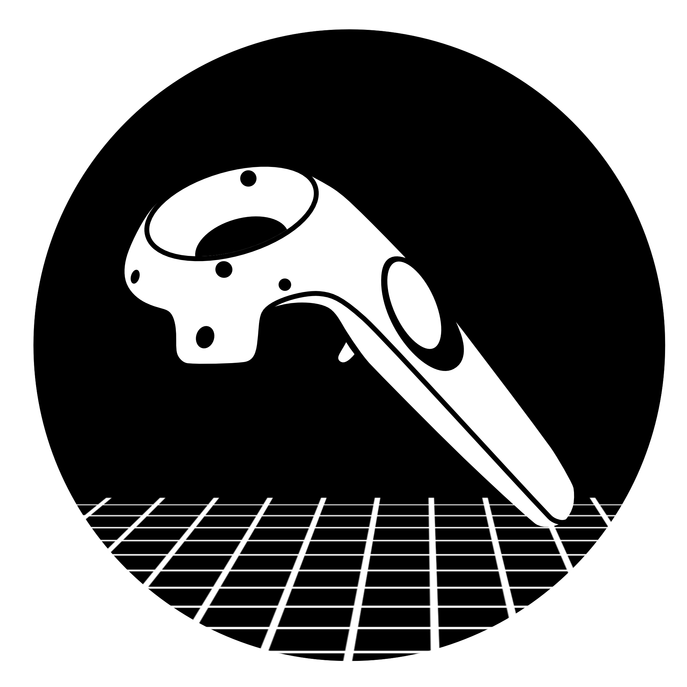
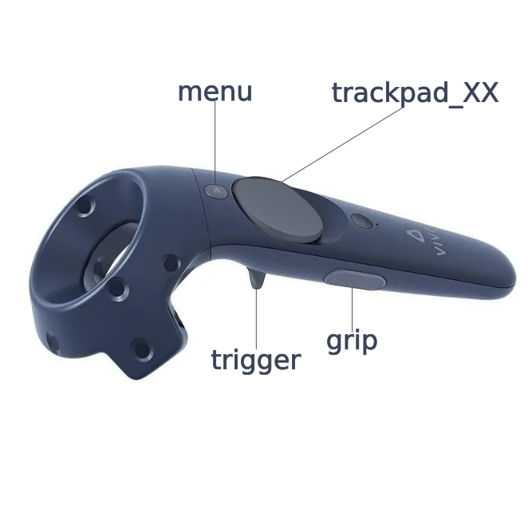
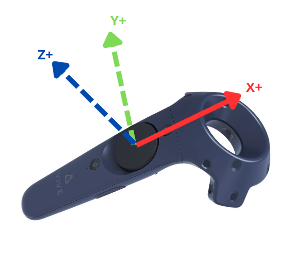

# ROS 2 Vive Controller
[](LICENSE)

A unified ROS 2 driver and teleoperation bridge for HTC Vive hardware (Controllers, Trackers 3.0, and Base Stations). This package provides a standalone, heavily optimized Dockerized workflow for workspace calibration, robot teleoperation, and reliable 6-DOF tracking.

|  | **Teleoperation in Action** |
| :---: | :---: |
|  |  |

---

## 📋 Table of Contents
- [🛠️ Prerequisites](#️-prerequisites)
- [⚙️ Configuration](#️-configuration)
- [🚀 Quick Start & Deployment](#-quick-start--deployment)
- [⚙️ The Vive Driver Node (`vive_node.py`)](#️-the-vive-driver-node-vive_nodepy)
- [🛠️ The Teleop Bridge Node (`teleop_bridge_node.py`)](#️-the-teleop-bridge-node-teleop_bridge_nodepy)
- [🤖 Adding Your Own Robot](#-adding-your-own-robot)
- [🧪 Tests](#-tests)

---

## 🛠️ Prerequisites

### Hardware
* **HTC Vive Base Stations** (Lighthouse): At least one is mandatory for tracking.
* **HTC Vive Controllers** or **Vive Trackers (3.0)**.
* **Micro USB to USB-A Cables**: For connecting the controllers to the host machine during setup and calibration.

### Software
* **Docker**
* **Make** (`sudo apt install make`).
* **Steam Account**: A valid username and password are required to download the headless SteamVR server during the initial Docker build.

---

## ⚙️ Configuration


### 1. .env file

This project relies on a `.env` file to map your specific hardware to the Docker containers.

1. Copy the template file:
   ```bash
   cp .env.template .env
   ```

2. Open `.env` and fill in your details:

```env
   # --- 1. Steam Credentials (For Build) ---
   STEAM_USER=your_steam_username
   STEAM_PASSWORD=your_steam_password

   # --- 2. Network & Scale ---
   ROS_DOMAIN_ID=2
   LINEAR_SCALE=1.75 # Adjust to scale operator movement to robot movement

   # --- 3. Hardware Serials ---
   SERIAL_LEFT=LHR-97752221       # Left Controller/Tracker ID
   SERIAL_RIGHT=LHR-4BB3817E      # Right Controller/Tracker ID
   REFERENCE_LIGHTHOUSE_SERIAL=LHB-2E7D2119 # The master Lighthouse used as the TF origin (0,0,0)
   ```
   > **The serials in `.env` are a fallback.** The easiest way to set the controllers and the origin base station is `make setup` (see Quick Start), which saves them in `config/station.yaml`. Once that file lists them, it wins over `.env`. A machine without it uses the `.env` serials, as before. Nothing falls back to hardcoded serials.
   >
   > **Tip:** `make identify` (no robot needed) lists every controller, tracker and base station SteamVR sees with its serial, battery and role, then vibrates each controller in turn.
   > Otherwise, you can run `sudo dmesg -w | grep "LHR"` for the controllers or `sudo dmesg -w | grep "LHB"` for the base stations while plugging them in to see their serial numbers in real time.

### 2. DDS Network Interface Name

Depending on the network interface used on your machine, you need to update the interface used by Cyclone DDS. For example, when using the Tiago Pro, edit both the `cyclonedds.xml` and `tiago_cyclonedds.xml` files.

Replace the following line with the name of your network interface:

```xml
<NetworkInterface name="enx607d09178f25" />
```

You can find your network interface name by running:

```bash
ip addr
```

or

```bash
ip link
```

Then replace `enx607d09178f25` with your interface name (e.g., `eno2`, `enp3s0`, `wlp2s0`, etc.).


---

## 🚀 Quick Start & Deployment

We use a `Makefile` to simplify interacting with the multi-profile `docker-compose.yml`. You never need to install ROS 2 or SteamVR on your host machine.

### 1. Build or Pull the Image (For Internal Usage)
> ⚠️ The pull step can only be used by our team members for now, for safety reasons we do not provide images publicly, since they require steam credentials to build.
```bash
# Option A (Internal): Pull the pre-built image from the registry
make pull

# Option B (Standard): Build it locally (requires STEAM_USER / STEAM_PASSWORD in .env)
make build
```

### 2. Set Up the Station
```bash
make setup
```
This starts a small web app next to SteamVR and prints its address (port `8800`, `SETUP_PORT` in `.env` to change it). Open it on the PC or on a tablet/phone on the same network:

1. **Robot**: the robot this machine drives (one of `config/robots/`).
2. **Hands**: press *Assign*, then pull the trigger of the controller in that hand. *Buzz* vibrates a controller.
3. **Origin**: the base station used as the origin frame, for robots whose profile uses one (Franka).
4. **Workspace fence**: press *Paint*, hold that hand's trigger and sweep the space the hand should reach, then *Done*. The 3D view shows the points, the fence, its warning band and the live controllers.

*Save* writes `config/station.yaml` (local to the machine, not tracked by git). Restart the robot to use it. If `make setup` finds a running vive container it attaches to its SteamVR. When teleop is running there, *Assign* and *Paint* are disabled, because a trigger pull would also move the robot.

`make setup-demo` runs the app with simulated controllers (no hardware, nothing saved), to try it out.

Where each value comes from:

| Value | Order (first one set wins) |
| :--- | :--- |
| Controller serials, origin base station | launch argument → `config/station.yaml` → `.env` (`SERIAL_RIGHT`, `SERIAL_LEFT`, `REFERENCE_LIGHTHOUSE_SERIAL`) |
| Workspace fence (per arm) | `config/station.yaml` → old `config/workspace.yaml` (both arms) → none |
| Scale, clutch reference | `.env` (`LINEAR_SCALE`, `CLUTCH_REFERENCE`) → robot profile → bridge default |

The launch log says where each serial came from, e.g. `Right controller: LHR-21C1BC92 (config/station.yaml)`.

### 3. Launch a Robot Mission
The `docker-compose.yml` is divided into specific robot profiles. Simply run the make command for your target hardware. This automatically passes X11 permissions for RViz, injects your `.env` variables, and sets the CycloneDDS network interfaces.
```bash
make teleop      # The robot chosen in make setup
make franka      # Start Franka (Single Right Arm)
make tiago       # Start TIAGo (Dual Arm)
make tiago_pro   # Start TIAGo Pro (Dual Arm)
make g1          # Start Unitree G1 (Dual Arm Humanoid)
```

### 4. Utilities
Manage the lifecycle and hardware with these helper commands:
```bash
make drivers     # Starts only the Vive drivers + RViz (no robot), e.g. to check the controllers
make identify    # Lists the connected Vive devices and vibrates each controller (no robot needed)
make calibrate   # Paints the right arm's fence in RViz instead of the web app (SIDE=left for the left arm)
make stop        # Safely shuts down running containers
make clean       # Removes all containers and orphans
```

Each `make <robot>` starts only that robot's container.

---

## ⚙️ The Vive Driver Node (`vive_node.py`)

The driver is the core interface between the OpenVR runtime and ROS 2. It handles hardware tracking, filtering, safety limits, and coordinate transformations.

### 🌟 Key Features

* **Dynamic Lighthouse Origin (Stable TF Tree):** Standard SteamVR uses an invisible, arbitrary "Standing Universe" origin. This node allows you to specify a `reference_lighthouse_serial`. If found, the node automatically computes the math to make that physical Lighthouse the exact $(0,0,0)$ origin of your TF tree. It even applies an automatic 180° Z-axis flip to correct standard Lighthouse hardware alignments.
  * Only robots whose profile has `use_origin_lighthouse: true` use it (**Franka**); TIAGo, TIAGo Pro and G1 publish in `vive_world`. Enabling it for another robot changes the frame its poses are published in, so its `rotation_offset` may need re-tuning.
  * Base Station 2.0 units can report their pose as *invalid* although it is calibrated. The node then stays in `vive_world` and logs a warning; set `allow_invalid_lighthouse_pose:=true` to use the stored pose anyway.
* **Hot-Plug Polling:** Uses continuous OpenVR event polling and looks devices up by serial on every cycle. If a tracker or lighthouse is turned on *after* the Docker container starts, or a controller is switched off and on again (battery swap, re-pairing), the node picks it up again without a restart, and the other side keeps tracking its own controller.
* **Reliable Poses Only:** SteamVR keeps flagging a partly covered controller's pose as valid while it only dead-reckons from the IMU, and those poses drift and jump. The driver only publishes poses SteamVR tracks optically (`Running_OK`), needs `tracking_ok_samples` (5) good samples in a row before publishing again, and logs the reason (`Tracking LOST for right (Running_OutOfRange)`). The teleop bridge then disengages through `pose_timeout`. Set `require_tracking_ok:=false` for the old behaviour.
  * **Known limitation (wired controllers):** SteamVR inside the container does not notice a controller on a USB cable that is unplugged or switched off and on again (its log shows the disconnect, then nothing). The driver keeps running and reports it missing; restart `make <robot>` to get it back. Wireless controllers (via a dongle that stays plugged in) are not affected by this.
* **Virtual Safety Fence (Haptics):** One box per arm, off until you paint it in `make setup` (or with `make calibrate`, in RViz). It is saved in `config/station.yaml` with the frame it was recorded in (the frame the chosen robot publishes in) and loaded the next time the drivers start. An old `config/workspace.yaml` still applies to the arms that have no fence in `config/station.yaml`.
  * **Warning band** (`workspace.padding`, 0.15 m inside the fence): the controller vibrates, the pose is still published.
  * **Outside the fence:** the controller vibrates and the pose is held back, so the teleop bridge disengages (see `pose_timeout`). Buttons are always published, so a clutch release is never missed.
  * The fence is ignored, with a warning, if it was recorded in another frame than the one the driver publishes in (e.g. with a different origin base station). Turn it off or remove it in `make setup`.
* **OneEuro Filtering:** Implements a high-speed, low-latency OneEuro filter to eliminate high-frequency hand jitter before it reaches the robot arm.

### 📊 Data Outputs & TF Tree

The driver automatically broadcasts a standard `tf2` tree:
`vive_world` ➔ `lighthouse_origin` (if configured) ➔ `vive_right_link`

It also publishes the following topics in its designated namespace (e.g., `/vive/right/`):

| Topic | Type | Description |
| :--- | :--- | :--- |
| `pose` | `geometry_msgs/PoseStamped` | Filtered 6-DOF position and orientation. Frame ID matches the Lighthouse if configured. |
| `joint_states` | `sensor_msgs/JointState` | The raw monolithic array of all analog/digital button inputs. |
| `workspace_marker` | `visualization_msgs/Marker` | A semi-transparent red cube for RViz representing the safe tracking zone. |

*(Note: You can trigger a massive haptic vibration via the `/vive/right/identify` service to figure out which controller you are holding).*

### 🕹️ Button Mapping (`joint_states`)

The driver publishes button inputs directly from OpenVR as a standard `JointState` array. The `position` array contains the values for the following keys:

| Index | Name | Type | Range | Description |
| :---: | :--- | :--- | :--- | :--- |
| **0** | `trigger` | Analog | `0.0` - `1.0` | The index finger trigger. Used for the **Clutch**. |
| **1** | `trackpad_x` | Analog | `-1.0` - `1.0` | Horizontal touch position on the round pad. |
| **2** | `trackpad_y` | Analog | `-1.0` - `1.0` | Vertical touch position on the round pad. |
| **3** | `grip` | Digital | `0.0` / `1.0` | The side grip buttons (squeezing the handle). |
| **4** | `menu` | Digital | `0.0` / `1.0` | The small button above the trackpad. |
| **5** | `trackpad_touched` | Digital | `0.0` / `1.0` | True if the thumb is touching the pad. |
| **6** | `trackpad_pressed` | Digital | `0.0` / `1.0` | True if the trackpad is physically clicked down. |

<div align="center">
  
</div>

> **Note:** Digital buttons are published as floats (`0.0` for False, `1.0` for True) to maintain consistency within the `JointState` message standard.

---

## 🛠️ The Teleop Bridge Node (`teleop_bridge_node.py`)

This node sits between the raw Vive Driver and your robot's Cartesian controllers. It implements a **Clutch Mechanism** (Deadman Switch) to allow for safe, intuitive teleoperation by separating translation and rotation logic.

### 🧠 Core Logic: Hybrid Positioning

To provide the most intuitive experience, the bridge treats position and orientation differently:

1. **Relative Translation (The Mouse Metaphor):** Position is calculated as a delta from the moment the clutch (the `trigger` button) is engaged. This allows you to "ratchet" the robot's position, moving it large distances through multiple small hand strokes while staying in a comfortable physical stance.
   * The clutch engages at a full pull and releases as soon as the trigger leaves it (`clutch_engage_threshold` / `clutch_release_threshold`, both `1.0`). For a worn trigger that never reaches `1.0`, set e.g. `0.95` / `0.90`: that also stops flickering near a full pull, but you then have to release the trigger further to ratchet.
   * Each new stroke starts from where TF says the end effector is (`clutch_reference: tf`, the default). If the robot's TF is delayed (e.g. clocks not synced with the robot), the arm can jump back to an old position when you clutch again. `clutch_reference: last_command` starts each stroke from the last commanded pose instead, which the arm is being held at; TF is then only used for the first stroke. Set `CLUTCH_REFERENCE=last_command` in `.env` (applies to every arm).
   * If no pose arrives for `pose_timeout` seconds (default `0.3`, `0` disables it) while the clutch is engaged, e.g. tracking is lost or the controller leaves the safety fence, the bridge disengages and keeps holding the last command. Release and press the trigger again to continue; the arm never jumps to wherever the controller reappears.
2. **Absolute Orientation (The Mirror Metaphor):** Rotation is **not relative**. For intuitive control, the robot's end-effector orientation directly mirrors the controller's orientation.
3. **Axis Realignment (`rotation_offset`):** Because a VR controller's physical axes rarely match a robot gripper's axes, the node supports a custom `[Roll, Pitch, Yaw]` offset parameter. It applies this rotation locally using Scipy matrix math so the robot moves exactly how your brain expects it to.

### 📐 Reference Frames & Alignment
To properly map the VR controller to your robot using `rotation_offset`, you must understand the controller's default OpenVR axes:

<div align="center">
  
</div>

* **Z-axis:** Points "out" from the controller tip.
* **X-axis:** Points to the right side of the controller.
* **Y-axis:** Points "up" through the trackpad.

### 🎮 Button Demultiplexing (`PointStamped`)

Standard ROS 2 robot controllers rarely accept monolithic `JointState` arrays for simple commands like opening a gripper.

The Teleop Bridge automatically "demultiplexes" the VR buttons. You can map any Vive button to its own dedicated topic in the robot profile (`buttons:`). The bridge publishes these as `geometry_msgs/PointStamped` messages (storing the analog/digital value in the `point.x` field), which is the standard format expected by many ROS 2 action servers and bridges.

### 🛡️ Trackpad Safety

The node includes a `trackpad_pressed_required` parameter. If set to `true`, lightly brushing your thumb over the trackpad will output `0.0`. It will only output the X/Y coordinates to your robot if you physically *click down* on the trackpad. This is critical for preventing accidental movement commands on mobile bases or humanoids. It only affects the `trackpad_x` / `trackpad_y` topics; the other buttons are always published as they are.

---

## 🤖 Adding Your Own Robot

The package is robot-agnostic: a robot is a YAML profile in `config/robots/`, with no Python or launch file to write. The profile says which arms are driven and how each `teleop_bridge_node` is set up; `robot_launch.py` builds the drivers, bridges and RViz from it. A mistyped key stops the launch with the list of valid keys.

```yaml
# config/robots/my_robot.yaml
description: My robot, dual arm
rviz: true
linear_scale: 1.0              # hand-to-robot translation scale (LINEAR_SCALE in .env overrides it)
use_origin_lighthouse: false   # true: poses in the origin base station frame instead of vive_world
arms:                          # left and/or right: one teleop bridge each
  right:
    output_topic: /my_robot/right_arm/target_pose   # the Cartesian controller's input
    reference_frame: base_link                      # robot root frame
    target_frame: right_gripper_link                # end effector frame
    publish_frequency: 30.0
    rotation_offset: [180.0, 0.0, 0.0]              # [roll, pitch, yaw] in degrees, see Reference Frames
    buttons:                                        # topics for the buttons; the others are /vive/right/<button>
      menu: /my_robot/right_gripper/toggle
  left:
    output_topic: /my_robot/left_arm/target_pose
    reference_frame: base_link
    target_frame: left_gripper_link
```

Any other `teleop_bridge_node` parameter can go under an arm (`trackpad_pressed_required`, `clutch_engage_threshold`, `clutch_release_threshold`, `pose_timeout`, `clutch_reference`). `franka.yaml` documents every key.

Try it with `ros2 launch ros2_vive_controller teleop.launch.py robot:=my_robot`. In the current image, use the file path instead (`ros2 launch /ros2_ws/src/ros2_vive_controller/launch/teleop.launch.py robot:=my_robot`); it is found by package name after the next `make build`.

### 🐳 Integrating with Docker and Make
1. Open `docker-compose.yml`, copy an existing robot block (like `tiago:`), rename it and its profile, and set its command to `ros2 launch /ros2_ws/src/ros2_vive_controller/launch/teleop.launch.py robot:=my_robot linear_scale:=${LINEAR_SCALE:-} clutch_reference:=${CLUTCH_REFERENCE:-}`.
2. Open `Makefile` and add a rule (e.g. `my_robot: gui-perms` with `docker compose --profile my_robot up`). `make setup` then lists the robot, and `make teleop` can start it.

## 🧪 Tests

The tests run without SteamVR or hardware: `ros2_vive_controller/testing/fake_openvr.py` stands in for OpenVR (the setup app's `--demo` mode uses it too). From the repository root, with the image you already use:

```bash
docker run --rm --user "$(id -u):$(id -g)" -e HOME=/tmp -e PYTHONDONTWRITEBYTECODE=1 --entrypoint bash \
  -v "$PWD":/work -w /work registry.gitlab.inria.fr/eurobin-horizon/code/ros2-vive-controller/vive-controller:latest \
  -lc "source /opt/ros/humble/setup.bash && python3 -m pytest -q -p no:cacheprovider test"
```

## 👥 Maintainers & Contributors

This package is actively developed by the **[HuCeBot Team](https://github.com/hucebot)** at Inria / Loria.


**Authors & Core Contributors:**
* Maintainers: **[Dionis Totsila](https://github.com/dtotsila)**, **[Jean-Baptiste Mouret](https://github.com/jbmouret)**
* Active contributors: **[Hippolyte Henry](https://github.com/hippolyte-bleu)**
* Other contributors: **[Clemente Donoso](https://github.com/cdonoso)**